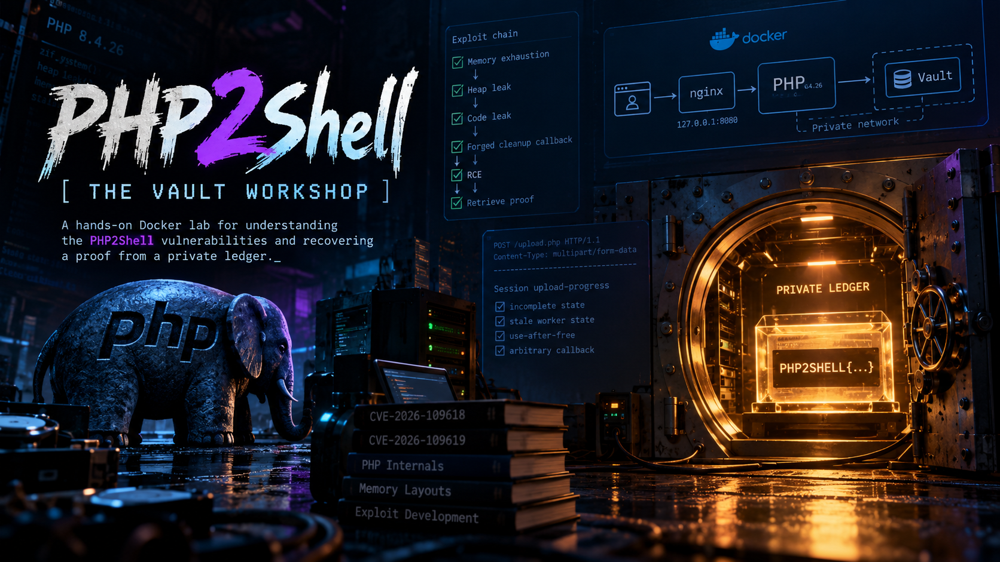

# ***🔐 PHP2Shell: The Vault Workshop***


<p align="center">
	
</p>


<p align="center">
	<i>A hands-on Docker lab for understanding the PHP2Shell vulnerabilities and recovering a proof from a private ledger. I originally created this workshop for people joining our research group who were new to PHP vulnerability research. It walks through the lab, the exploit chain, and the debugging process step by step so students can understand why each stage works. I'm now sharing it with everyone who wants to learn. You can follow it at your own pace, reproduce the results in the local Docker environment, and use the analysis exercises to explore how PHP builds and memory layouts affect exploitation.</i>
</p>


---
---
---


## ***🧭 Contents***

1. [Scenario](#Scenario)
2. [Start the lab](#Lab)
3. [Student route](#Student)
4. [How the chain works](#Chain)
5. [Files and references](#Files)


---
---
---


<div id='Scenario'/>

## ***🎯 Scenario***

Your browser reaches nginx on `127.0.0.1:8080`. It forwards requests to **PHP 8.4.26** running four CLI server workers. The PHP container can reach a separate ledger vault on a private Docker network. The vault key and final `PHP2SHELL{...}` proof are generated when the services start.

This workshop uses **one** build-specific target and two PoC entry points that share the same exploit stages. The guided PoC retrieves the vault proof; the second accepts a short selected command. Both are restricted to this local lab. They derive from [KillaBoi's Steal My Bitcoin PHP 8.4.26 research](https://github.com/KillaBoi/StealMyBitcoin-PoC). OffSec's [Exploit Database example](https://www.exploit-db.com/exploits/52704) targets a different PHP build; its constants cannot be copied into this one.


---
---
---


<div id='Lab'/>

## ***🚀 Start the lab***

From the repository root:

```console
docker compose up --build -d
docker compose ps
```

Open [the landing page](http://127.0.0.1:8080/) and [the version endpoint](http://127.0.0.1:8080/php-version.php). The latter should show PHP 8.4.26. The vault is reachable only from the PHP container.

Run the local proof of concept:

```console
python PoC/Script01_Php2Shell.py --url http://127.0.0.1:8080/php-version.php
```

The script attempts memory exhaustion, a heap leak, a code leak, and a forged cleanup callback. It prints its observations and records a run transcript. Successful exploitation should yield an execution proof and a vault JSON response containing `PHP2SHELL{...}`. The race can fail; do not interpret one failed attempt as evidence the build is patched. Keep run artifacts local. For the full investigation, the selected-command PoC can read the operator note, then run `ledger records` before retrieving the wallet proof; [Student.md](Student.md) gives the exact sequence.

After the guided run, try a selected local command with `python PoC/Script02_LocalCommand.py --command "id"`. It records the running PHP version and binary hash. If either differs from the validated build, it warns and still makes bounded local attempts with the old calibration. [The offset lesson](Analysis/Script04_OffsetsAndPorting.md), [worker-map helper](Analysis/Script05_WorkerMaps.py), and [surprise-version assignment](Analysis/Script06_SurpriseVersion.md) show what must be measured again for a different build.

To stop: `docker compose down`. Starting the vault container again generates a new key and proof. Restarting only PHP after a crash preserves the current vault proof; `docker compose up -d php` is enough.


---
---
---


<div id='Student'/>

## ***🧑‍🎓 Student route***

Start with [Student.md](Student.md), then work through [Analysis/README.md](Analysis/README.md) in order. The analysis folder contains target and build probes, an explanation of both CVEs, a function-by-function PoC walkthrough, run-report debugging, ELF inspection, live process maps, and a version-change assignment. Read [PoC/README.md](PoC/README.md) with the script open before running it. [Instructor.md](Instructor.md) contains validation and teaching checkpoints.


---
---
---


<div id='Chain'/>

## ***🧠 How the chain works***

The workshop discusses [CVE-2026-109618](https://github.com/php/php-src/security/advisories/GHSA-w8hw-w9fx-j79w), which covers OOM corruption around incompletely initialized request state, and [CVE-2026-109619](https://github.com/php/php-src/security/advisories/GHSA-6wmf-4rv5-p3rp), which covers stale worker global state consumed across requests. The supplied PoC follows the **session upload-progress lifecycle case described under CVE-2026-109619**: a multipart request exhausts memory, and a later request on the surviving worker consumes stale session state. The PoC uses the resulting disclosures to learn heap and code addresses before redirecting a cleanup callback to `zif_system`. The advisories describe related mechanisms, but students should not treat the two CVE IDs as interchangeable.


---
---
---


<div id='Files'/>

## ***📁 Files and references***

| Path | Purpose |
|---|---|
| `compose.yaml`, `Dockerfile`, `Docker/` | One PHP/nginx/vault environment |
| `Public/` | Landing page and version endpoint |
| `Vault/`, `Challenge/` | Private ledger and post-compromise clues |
| `PoC/` | Guided vault PoC and selected-command PoC on the same pinned lab |
| `Analysis/` | Read-only probes, CVE lesson, code walkthrough, debugging, offset inspection, and version-change worksheet |
| `Student.md`, `Instructor.md` | Classroom instructions and validation |

[Calif PHP2Shell](https://calif.io/php2shell/) · [Wiz PHP2Shell](https://www.wiz.io/blog/php2shell-php-rce) · [PHP source](https://github.com/php/php-src) · [KillaBoi PoC](https://github.com/KillaBoi/StealMyBitcoin-PoC) · [OffSec example](https://www.exploit-db.com/exploits/52704).
